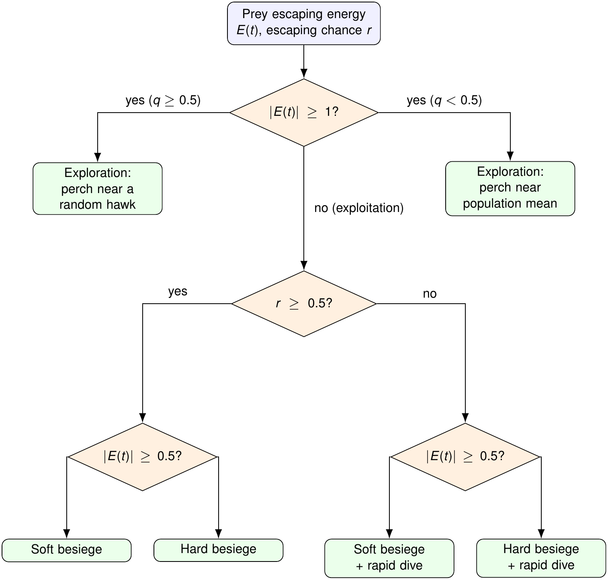
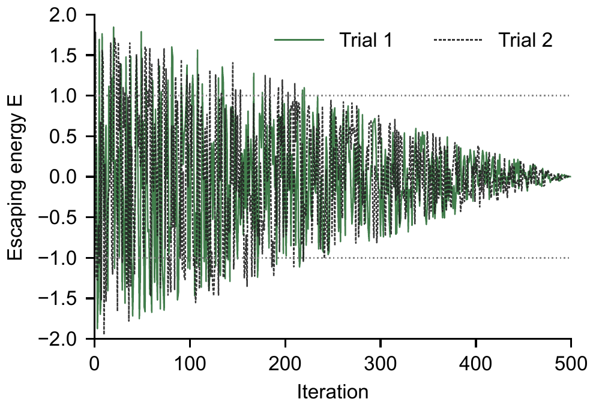
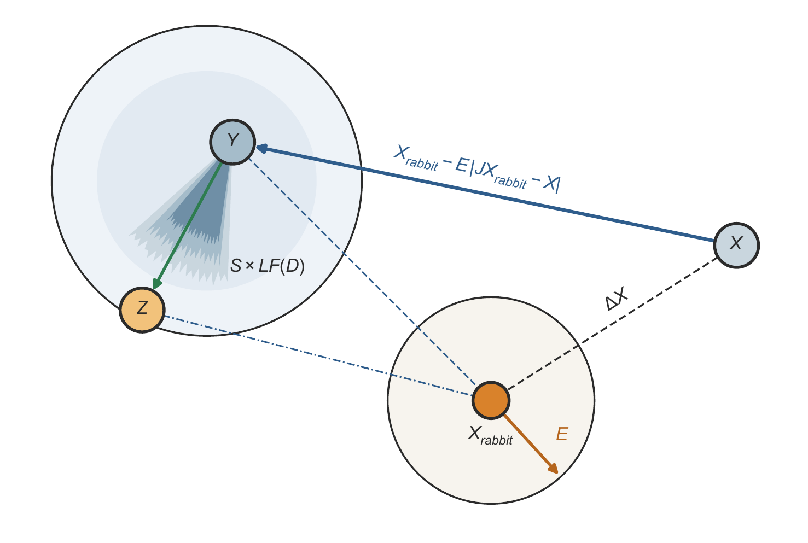
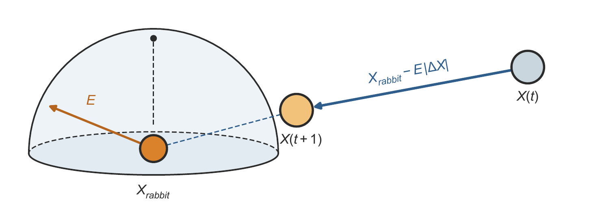
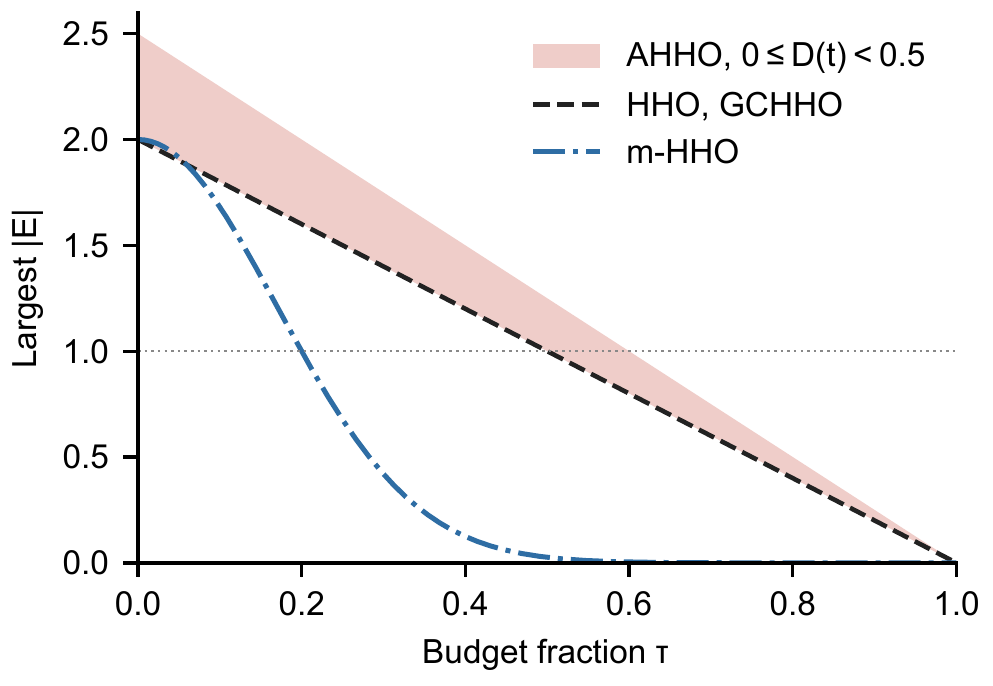
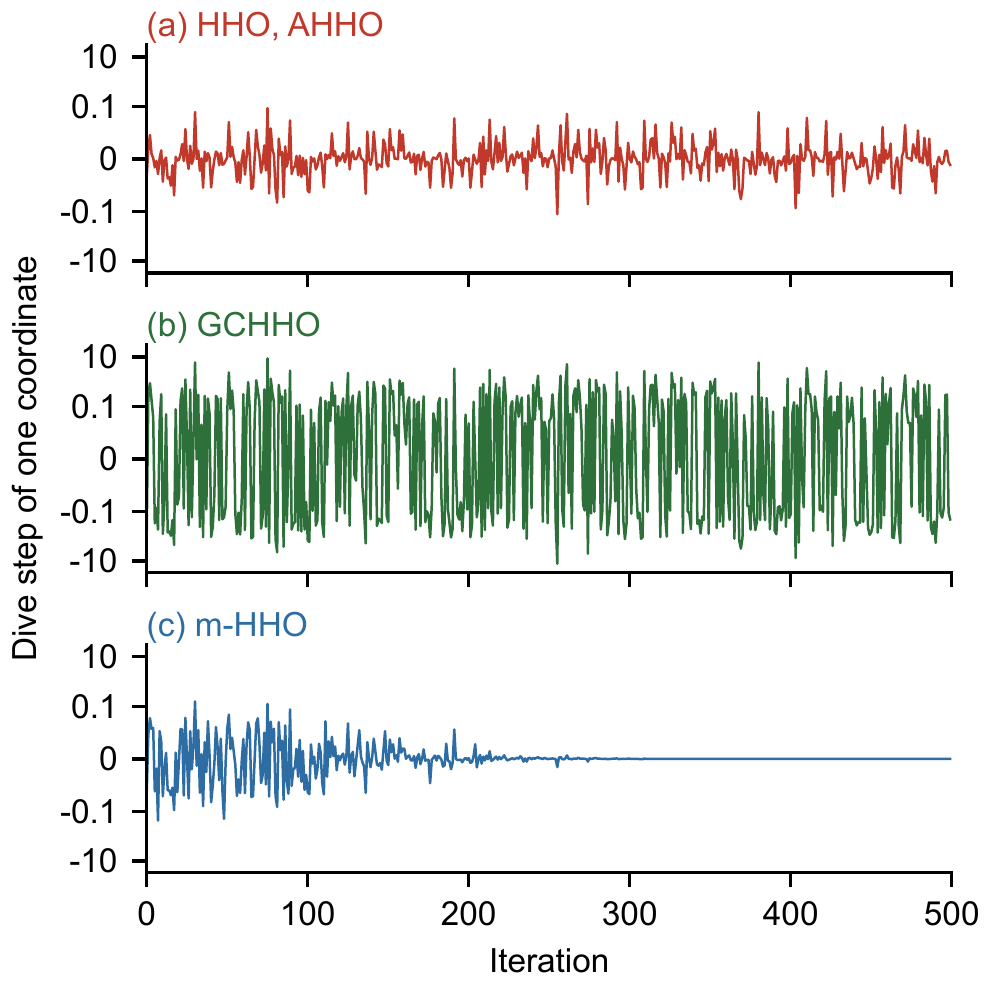
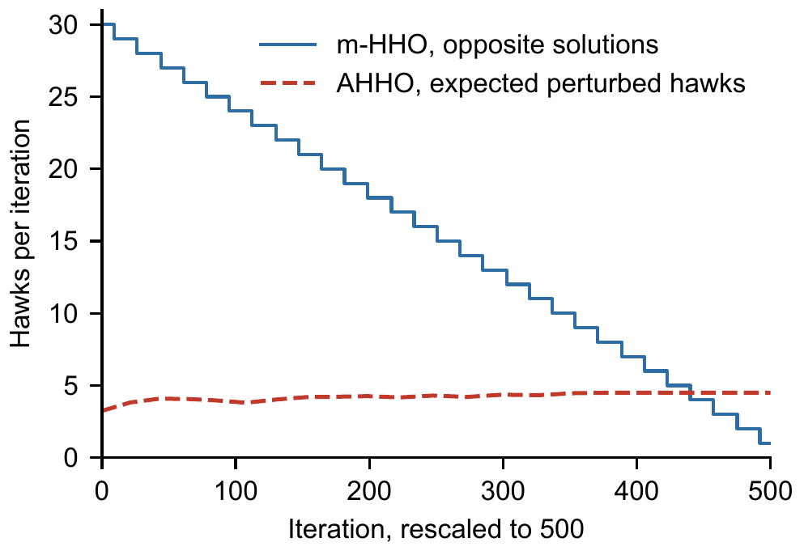
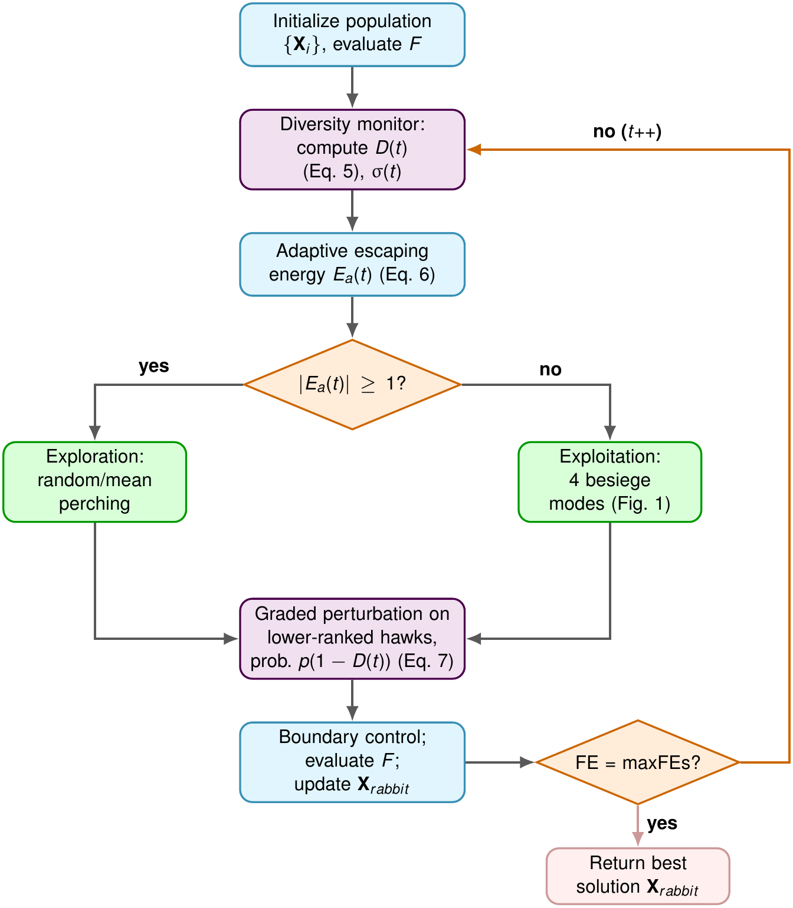
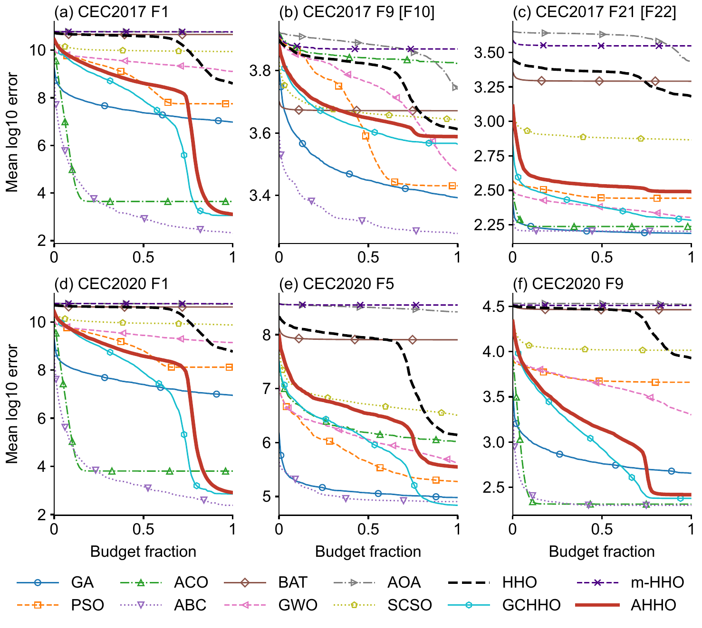

<h1 align="center">Adaptive Harris Hawks Optimization (AHHO)</h1>

<p align="center"><b>AHHO: A Diversity-Triggered Perturbation and Adaptive-Energy Extension of Harris Hawks Optimization Evaluated on CEC Benchmarks and Engineering Design Problems</b></p>

<p align="center">
Phayung Meesad<sup>1</sup>, Van Van Chau<sup>1,2,*</sup>, Tuan Minh Nguyen<sup>2,*</sup><br>
<sup>1</sup> Department of Information Technology Management, King Mongkut's University of Technology North Bangkok, Bangkok, Thailand<br>
<sup>2</sup> Faculty of Information Technology, Posts and Telecommunications Institute of Technology, Ho Chi Minh City, Vietnam<br>
<sup>*</sup> Corresponding authors: vancv@ptit.edu.vn, minhtuan@ptit.edu.vn
</p>

<p align="center"><i>Neural Computing and Applications</i>, under review</p>

<p align="center">


</p>

**Contents:** [Abstract](#abstract) · [Contributions](#contributions) · [Method](#method) · [Protocol](#experimental-protocol) · [Results](#results) · [Reproducing](#reproducing-the-study) · [Layout](#repository-layout) · [Citation](#citation)

## Abstract
Harris Hawks Optimization (HHO) is a widely used swarm-intelligence method for non-convex black-box problems. Its shift from exploration to exploitation is driven by an escaping energy that decays with time alone, whatever the actual spread of the population. Chaotic, opposition-based and Gaussian-mutation variants change the search operators, yet none of those we reviewed ties this shift to a measured diversity signal. This study proposes Adaptive Harris Hawks Optimization (AHHO). It scales the escaping energy by a normalized diversity statistic computed at every iteration. It also adds a diversity-triggered Gaussian perturbation whose step follows the current population spread, with a nonzero floor that keeps a collapsed swarm moving. AHHO was compared with eleven optimizers, including two HHO variants, on the CEC2017 and CEC2020 suites and on four constrained engineering design problems. Every optimizer received the same number of objective evaluations, and a factorial ablation and a sensitivity study isolated each mechanism. Log-transformed errors were analyzed with Friedman ranks and Holm-corrected Wilcoxon signed-rank tests. AHHO outperformed the original algorithm on both numerical suites and never lost to it on the engineering problems. It was also significantly better than several established baselines, although it ranked sixth of twelve optimizers overall. The ablation showed that the perturbation, not the energy coupling, accounts for most of the gain. AHHO is therefore a diversity-aware refinement of HHO rather than a new best optimizer, and the ablation identifies which of its two mechanisms carries the improvement.

## Contributions
1. AHHO is proposed, introducing a diversity-modulated escaping-energy mechanism and a diversity-triggered adaptive perturbation that is explicitly scaled by the current population spread rather than the full search-space range, with a nonzero floor that keeps it active in a collapsed swarm.
2. AHHO is benchmarked against eleven optimizers, namely GA, PSO, GWO, ACO, ABC, BAT, AOA, SCSO, the original HHO and two HHO variants, on ten CEC2017 functions at dimension 30 spanning unimodal, multimodal, hybrid, and composition categories. Each function–algorithm pair uses 30 independent runs under an identical, exactly enforced evaluation budget.
3. The same protocol is independently replicated on all ten functions of the CEC2020 numerical benchmark suite without retuning any parameter, providing a cross-suite robustness check on AHHO's relative ranking against the same eleven optimizers.
4. AHHO is further evaluated on four classic constrained engineering design problems, namely pressure vessel, welded beam, tension/compression spring, and speed reducer design. Original objective, penalized fitness, maximum constraint violation and feasibility rate are reported separately, providing preliminary evidence of behavior beyond synthetic numerical functions.
5. A factorial ablation study isolates the individual and joint contribution of the two proposed mechanisms relative to the original HHO, and a one-factor-at-a-time sensitivity study shows that making every hawk except the best eligible for perturbation is significantly better than the default median split, which a separate run on new seeds confirmed.
6. The diversity statistic is analyzed formally, including its upper bound and its behavior in collapsed and widely spread populations, and a controlled collapse experiment tests the perturbation floor.
7. Performance differences are assessed on log-transformed errors with a non-parametric statistical protocol, the Friedman test followed by Holm-corrected pairwise Wilcoxon signed-rank tests, rather than relying on mean performance alone.

## Method
AHHO keeps every operator of HHO and adds two modifications. The escaping energy is multiplied by a factor that grows with a normalized population-diversity statistic D(t), and a diversity-triggered Gaussian perturbation moves the worse hawks with a step that follows the current population spread, floored at δ times the search range. The statistic, the spread and the fitness ranking are computed from the population at the start of each iteration.

<p align="center"></p>
<p align="center"><em>Fig. 1. Main phases of HHO</em> &nbsp; <a href="figures/fig1_hho_hunting.pdf">[PDF]</a></p>

<p align="center"></p>
<p align="center"><em>Fig. 2. Escaping energy over two trials and 500 iterations</em> &nbsp; <a href="figures/fig2_energy_trials.pdf">[PDF]</a></p>

<p align="center"></p>
<p align="center"><em>Fig. 3a. Soft besiege with progressive rapid dives</em> &nbsp; <a href="figures/fig3a_soft_besiege_dive.pdf">[PDF]</a></p>
<p align="center"></p>
<p align="center"><em>Fig. 3b. Hard besiege</em> &nbsp; <a href="figures/fig3b_hard_besiege.pdf">[PDF]</a></p>

<p align="center"></p>
<p align="center"><em>Fig. 4. Energy ceiling of HHO, AHHO and m-HHO</em> &nbsp; <a href="figures/fig4_energy_envelope.pdf">[PDF]</a></p>

<p align="center"></p>
<p align="center"><em>Fig. 5. Rapid-dive step of one coordinate</em> &nbsp; <a href="figures/fig5_dive_steps.pdf">[PDF]</a></p>

<p align="center"></p>
<p align="center"><em>Fig. 6. Perturbed hawks and opposite solutions per iteration</em> &nbsp; <a href="figures/fig6_perturbed_hawks.pdf">[PDF]</a></p>

<p align="center"></p>
<p align="center"><em>Fig. 7. Overall AHHO workflow</em> &nbsp; <a href="figures/fig7_ahho_architecture.pdf">[PDF]</a></p>

## Experimental protocol
| Part | Problems | Budget | Runs |
|---|---|---|---|
| A | Ten CEC2017 functions, d = 30 | 150,000 function evaluations | 30 per function and optimizer |
| B | Pressure vessel, welded beam, tension/compression spring, speed reducer | 30,000 function evaluations | 30 per problem and optimizer |
| C | All ten CEC2020 functions, d = 30 | 150,000 function evaluations | 30 per function and optimizer |

Every optimizer uses N = 30 and the same evaluation counter: each objective call counts as one evaluation, including the initial population, dive candidates, onlookers, scouts and perturbed hawks, and a run stops at exactly the budget. Schedules use the consumed budget fraction τ = FE/maxFEs. The CEC functions come from opfunu 1.0.4; its labels Fk with k ≥ 2 correspond to the official CEC2017 F(k+1). The AHHO settings α = 0.5, p = 0.3, β<sub>max</sub> = 0.5, β<sub>min</sub> = 0.05 and δ = 10<sup>-3</sup> are the same on every function and problem.

The primary measure on the CEC functions is the mean of log10(error + 10<sup>-8</sup>) over the 30 runs. Optimizers are compared by Friedman ranks and Holm-corrected Wilcoxon signed-rank tests across functions; per function, run-level paired Wilcoxon tests with Holm correction give win, tie and loss counts. The engineering problems use the penalized fitness *F* for ranking and report the original objective *f*, the largest constraint violation and the feasibility rate separately.

## Results
<p><b>Table 6.</b> Average Friedman ranks, lower is better</p>

<table>
<thead>
<tr><th align="left">Optimizer</th><th align="center">CEC2017</th><th align="center">CEC2020</th><th align="center">CEC Suites</th><th align="center">CEC Suites, raw mean</th><th align="center">Engineering</th></tr>
</thead>
<tbody>
<tr><td align="left">GA</td><td align="right">3.50</td><td align="right">3.10</td><td align="right">3.30</td><td align="right">3.15</td><td align="right">7.75</td></tr>
<tr><td align="left">PSO</td><td align="right">4.60</td><td align="right">5.50</td><td align="right">5.05</td><td align="right">5.70</td><td align="right">3.50</td></tr>
<tr><td align="left">ACO</td><td align="right">4.00</td><td align="right">3.90</td><td align="right">3.95</td><td align="right">3.95</td><td align="right">4.62</td></tr>
<tr><td align="left">ABC</td><td align="right">1.70</td><td align="right">1.50</td><td align="right">1.60</td><td align="right">1.60</td><td align="right">3.12</td></tr>
<tr><td align="left">BAT</td><td align="right">10.00</td><td align="right">9.80</td><td align="right">9.90</td><td align="right">9.95</td><td align="right">10.00</td></tr>
<tr><td align="left">GWO</td><td align="right">5.50</td><td align="right">6.20</td><td align="right">5.85</td><td align="right">5.60</td><td align="right">2.50</td></tr>
<tr><td align="left">AOA</td><td align="right">10.60</td><td align="right">11.10</td><td align="right">10.85</td><td align="right">10.75</td><td align="right">6.00</td></tr>
<tr><td align="left">SCSO</td><td align="right">8.70</td><td align="right">8.90</td><td align="right">8.80</td><td align="right">8.65</td><td align="right">8.50</td></tr>
<tr><td align="left">HHO</td><td align="right">8.20</td><td align="right">7.80</td><td align="right">8.00</td><td align="right">7.85</td><td align="right">10.00</td></tr>
<tr><td align="left">GCHHO</td><td align="right">3.70</td><td align="right">3.00</td><td align="right">3.35</td><td align="right">3.55</td><td align="right">4.00</td></tr>
<tr><td align="left">m-HHO</td><td align="right">11.90</td><td align="right">11.80</td><td align="right">11.85</td><td align="right">11.90</td><td align="right">12.00</td></tr>
<tr><td align="left">AHHO</td><td align="right">5.60</td><td align="right">5.40</td><td align="right">5.50</td><td align="right">5.35</td><td align="right">6.00</td></tr>
<tr><td align="left">Friedman <i>p</i></td><td align="right">1.4e-14</td><td align="right">8.8e-16</td><td align="right">6.1e-34</td><td align="right">2.8e-33</td><td align="right">5.4e-04</td></tr>
</tbody>
</table>

<p><b>Table 7.</b> AHHO against each optimizer</p>

<table>
<thead>
<tr><th align="left"></th><th colspan=3 align="center">CEC2017</th><th colspan=3 align="center">CEC2020</th><th align="center">Engineering</th></tr>
<tr><th align="left">Optimizer</th><th align="center">AHHO better</th><th align="center"><i>p</i> Holm</th><th align="center">W/T/L</th><th align="center">AHHO better</th><th align="center"><i>p</i> Holm</th><th align="center">W/T/L</th><th align="center">W/T/L</th></tr>
</thead>
<tbody>
<tr><td align="left">GA</td><td align="right">3/10</td><td align="right">0.697</td><td align="right">1/2/7</td><td align="right">2/10</td><td align="right">0.773</td><td align="right">2/1/7</td><td align="right">2/1/1</td></tr>
<tr><td align="left">PSO</td><td align="right">4/10</td><td align="right">1.000</td><td align="right">3/2/5</td><td align="right">5/10</td><td align="right">0.967</td><td align="right">3/2/5</td><td align="right">1/0/3</td></tr>
<tr><td align="left">ACO</td><td align="right">2/10</td><td align="right">0.641</td><td align="right">2/2/6</td><td align="right">3/10</td><td align="right">0.967</td><td align="right">3/1/6</td><td align="right">0/3/1</td></tr>
<tr><td align="left">ABC</td><td align="right">0/10</td><td align="right">0.021</td><td align="right">0/1/9</td><td align="right">0/10</td><td align="right">0.021</td><td align="right">0/0/10</td><td align="right">1/0/3</td></tr>
<tr><td align="left">BAT</td><td align="right">10/10</td><td align="right">0.021</td><td align="right">10/0/0</td><td align="right">10/10</td><td align="right">0.021</td><td align="right">10/0/0</td><td align="right">4/0/0</td></tr>
<tr><td align="left">GWO</td><td align="right">5/10</td><td align="right">1.000</td><td align="right">4/2/4</td><td align="right">6/10</td><td align="right">0.967</td><td align="right">4/3/3</td><td align="right">1/0/3</td></tr>
<tr><td align="left">AOA</td><td align="right">9/10</td><td align="right">0.023</td><td align="right">9/1/0</td><td align="right">10/10</td><td align="right">0.021</td><td align="right">10/0/0</td><td align="right">2/2/0</td></tr>
<tr><td align="left">SCSO</td><td align="right">10/10</td><td align="right">0.021</td><td align="right">9/1/0</td><td align="right">10/10</td><td align="right">0.021</td><td align="right">10/0/0</td><td align="right">3/1/0</td></tr>
<tr><td align="left">HHO</td><td align="right">10/10</td><td align="right">0.021</td><td align="right">9/1/0</td><td align="right">10/10</td><td align="right">0.021</td><td align="right">9/1/0</td><td align="right">2/2/0</td></tr>
<tr><td align="left">GCHHO</td><td align="right">1/10</td><td align="right">0.023</td><td align="right">0/4/6</td><td align="right">0/10</td><td align="right">0.021</td><td align="right">0/2/8</td><td align="right">0/2/2</td></tr>
<tr><td align="left">m-HHO</td><td align="right">10/10</td><td align="right">0.021</td><td align="right">10/0/0</td><td align="right">10/10</td><td align="right">0.021</td><td align="right">10/0/0</td><td align="right">4/0/0</td></tr>
</tbody>
</table>

<p><i>Note.</i> AHHO better counts the functions on which AHHO has the lower mean log error. W/T/L counts functions on which AHHO wins, ties or loses in run-level Wilcoxon tests, Holm-corrected within each function.</p>

<p align="center"></p>
<p align="center"><em>Fig. 8. Mean convergence of the twelve optimizers</em> &nbsp; <a href="figures/fig8_convergence.pdf">[PDF]</a></p>

<p><b>Table 12.</b> Factorial ablation: average ranks among the four variants</p>

<table>
<thead>
<tr><th align="left">Variant</th><th align="center">Energy</th><th align="center">Perturbation</th><th align="center">CEC2017</th><th align="center">CEC2020</th><th align="center">Engineering</th><th align="center"><i>p</i> Holm vs AHHO</th></tr>
</thead>
<tbody>
<tr><td align="left">HHO</td><td align="right">No</td><td align="right">No</td><td align="right">3.40</td><td align="right">3.60</td><td align="right">3.50</td><td align="right"><0.001</td></tr>
<tr><td align="left">AHHO-EnergyOnly</td><td align="right">Yes</td><td align="right">No</td><td align="right">3.60</td><td align="right">3.40</td><td align="right">3.00</td><td align="right"><0.001</td></tr>
<tr><td align="left">AHHO-PerturbOnly</td><td align="right">No</td><td align="right">Yes</td><td align="right">1.30</td><td align="right">1.30</td><td align="right">2.25</td><td align="right">0.231</td></tr>
<tr><td align="left">AHHO-Full</td><td align="right">Yes</td><td align="right">Yes</td><td align="right">1.70</td><td align="right">1.70</td><td align="right">1.25</td><td align="right">–</td></tr>
</tbody>
</table>

<p><i>Note.</i> The <i>p</i> values compare mean log errors over the 20 CEC functions.</p>

<p><b>Table 13.</b> One-factor-at-a-time sensitivity of AHHO</p>

<table>
<thead>
<tr><th align="left">Setting</th><th align="center">Rank, CEC Suites</th><th align="center">Better than default</th><th align="center"><i>p</i> Holm</th><th align="center">Rank, engineering</th></tr>
</thead>
<tbody>
<tr><td align="left">α=0.25</td><td align="right">6.60</td><td align="right">15/20</td><td align="right">0.207</td><td align="right">10.00</td></tr>
<tr><td align="left">α=1</td><td align="right">7.65</td><td align="right">10/20</td><td align="right">1.000</td><td align="right">9.50</td></tr>
<tr><td align="left">p=0.15</td><td align="right">11.25</td><td align="right">5/20</td><td align="right">0.017</td><td align="right">11.00</td></tr>
<tr><td align="left">p=0.6</td><td align="right">5.30</td><td align="right">17/20</td><td align="right">0.053</td><td align="right">10.25</td></tr>
<tr><td align="left">β<sub>max</sub>=0.25</td><td align="right">8.05</td><td align="right">12/20</td><td align="right">1.000</td><td align="right">10.50</td></tr>
<tr><td align="left">β<sub>max</sub>=1</td><td align="right">8.50</td><td align="right">10/20</td><td align="right">1.000</td><td align="right">8.25</td></tr>
<tr><td align="left">β<sub>min</sub>=0.01</td><td align="right">8.40</td><td align="right">11/20</td><td align="right">1.000</td><td align="right">7.25</td></tr>
<tr><td align="left">β<sub>min</sub>=0.1</td><td align="right">6.60</td><td align="right">14/20</td><td align="right">0.154</td><td align="right">6.50</td></tr>
<tr><td align="left">δ=0</td><td align="right">11.50</td><td align="right">5/20</td><td align="right">0.138</td><td align="right">4.25</td></tr>
<tr><td align="left">δ=10<sup>-4</sup></td><td align="right">8.80</td><td align="right">8/20</td><td align="right">1.000</td><td align="right">4.25</td></tr>
<tr><td align="left">δ=10<sup>-2</sup></td><td align="right">8.65</td><td align="right">12/20</td><td align="right">1.000</td><td align="right">7.75</td></tr>
<tr><td align="left">fraction 0.25</td><td align="right">12.60</td><td align="right">3/20</td><td align="right">0.001</td><td align="right">13.00</td></tr>
<tr><td align="left">fraction 0.75</td><td align="right">4.50</td><td align="right">17/20</td><td align="right">0.056</td><td align="right">7.25</td></tr>
<tr><td align="left">fraction 1</td><td align="right">2.80</td><td align="right">17/20</td><td align="right">0.009</td><td align="right">5.50</td></tr>
<tr><td align="left">Default</td><td align="right">8.80</td><td align="right">–</td><td align="right">–</td><td align="right">4.75</td></tr>
</tbody>
</table>

<p><i>Note.</i> Ranks are among the 15 settings. Default: α=0.5, p=0.3, β<sub>max</sub>=0.5, β<sub>min</sub>=0.05, δ=10<sup>-3</sup>, fraction 0.5.</p>

<p><b>Table 14.</b> Confirmation of fraction 1 against the default on new seeds</p>

<table><thead><tr><th align="left">Problem set</th><th align="center">Problems</th><th align="center">Lower mean error with fraction 1</th><th align="center">Run-level W/T/L</th></tr></thead><tbody><tr><td align="left">CEC2017</td><td align="right">10</td><td align="right">9</td><td align="right">0/10/0</td></tr><tr><td align="left">CEC2020</td><td align="right">10</td><td align="right">10</td><td align="right">3/7/0</td></tr><tr><td align="left">Engineering</td><td align="right">4</td><td align="right">3</td><td align="right">0/4/0</td></tr></tbody></table>

<p><i>Note.</i> Wilcoxon signed-rank test over the 20 CEC functions: <i>p</i> = 3.8×10<sup>-6</sup>, which met the criterion fixed before the run. W/T/L counts paired run-level Wilcoxon tests with Holm correction from the perspective of fraction 1. Engineering compares penalized fitness.</p>

<p><b>Table 15.</b> Median final error after a forced collapse at 70% of the budget</p>

<table>
<thead>
<tr><th align="left">Function</th><th align="center">HHO</th><th align="center">δ=0</th><th align="center"><i>p</i> Holm</th><th align="center">δ=10<sup>-2</sup></th><th align="center"><i>p</i> Holm</th><th align="center">δ=10<sup>-3</sup></th><th align="center"><i>p</i> Holm</th></tr>
</thead>
<tbody>
<tr><td align="left">CEC2017 F5 [F6]</td><td align="right">1.951E-03</td><td align="right">1.229E-03</td><td align="right">0.048</td><td align="right">6.151E-04</td><td align="right">0.001</td><td align="right">4.291E-04</td><td align="right"><0.001</td></tr>
<tr><td align="left">CEC2017 F7 [F8]</td><td align="right">6.631E+02</td><td align="right">5.995E+02</td><td align="right">0.043</td><td align="right">6.003E+02</td><td align="right"><0.001</td><td align="right">5.935E+02</td><td align="right">0.001</td></tr>
<tr><td align="left">CEC2017 F9 [F10]</td><td align="right">4.314E+03</td><td align="right">4.116E+03</td><td align="right">0.868</td><td align="right">3.983E+03</td><td align="right">0.079</td><td align="right">4.196E+03</td><td align="right">0.868</td></tr>
<tr><td align="left">CEC2017 F21 [F22]</td><td align="right">3.305E+03</td><td align="right">3.079E+03</td><td align="right">0.225</td><td align="right">2.961E+03</td><td align="right">0.166</td><td align="right">3.114E+03</td><td align="right">0.868</td></tr>
<tr><td align="left">CEC2020 F2</td><td align="right">4.739E+03</td><td align="right">4.454E+03</td><td align="right">0.368</td><td align="right">4.251E+03</td><td align="right">0.057</td><td align="right">4.310E+03</td><td align="right">0.010</td></tr>
<tr><td align="left">CEC2020 F3</td><td align="right">7.431E+04</td><td align="right">1.748E+04</td><td align="right"><0.001</td><td align="right">6.164E+02</td><td align="right"><0.001</td><td align="right">7.869E+03</td><td align="right"><0.001</td></tr>
<tr><td align="left">Minimum logged D(t)</td><td align="right">–</td><td align="right">4.011E-18</td><td align="right"></td><td align="right">9.141E-09</td><td align="right"></td><td align="right">9.141E-09</td><td align="right"></td></tr>
</tbody>
</table>

<p><i>Note.</i> δ=10<sup>-3</sup> is the default. The <i>p</i> values compare each AHHO setting with HHO over paired runs.</p>

<details>
<summary><b>Engineering design problems: objective, violation and feasibility</b></summary>

<p><b>Table 10.</b> Original objective, violation and feasibility on the engineering problems</p>

<table>
<thead>
<tr><th align="left">Problem</th><th align="center">Optimizer</th><th align="center">Mean <i>f</i></th><th align="center">Max violation</th><th align="center">Feasible 10<sup>-4</sup></th><th align="center">Feasible 10<sup>-6</sup></th><th align="center">Best feasible <i>f</i></th></tr>
</thead>
<tbody>
<tr><td rowspan=12 align="left">Pressure vessel</td><td align="left">GA</td><td align="right">6.574E+03</td><td align="right">3.705E-04</td><td align="right">0.00</td><td align="right">0.00</td><td align="right">5.934E+03</td></tr>
<tr><td align="left">PSO</td><td align="right">6.217E+03</td><td align="right">3.782E-04</td><td align="right">0.03</td><td align="right">0.03</td><td align="right">5.885E+03</td></tr>
<tr><td align="left">ACO</td><td align="right">6.501E+03</td><td align="right">4.105E-04</td><td align="right">0.03</td><td align="right">0.03</td><td align="right">5.885E+03</td></tr>
<tr><td align="left">ABC</td><td align="right">6.038E+03</td><td align="right">1.895E-03</td><td align="right">0.50</td><td align="right">0.50</td><td align="right">5.936E+03</td></tr>
<tr><td align="left">BAT</td><td align="right">7.902E+03</td><td align="right">3.492E-03</td><td align="right">0.60</td><td align="right">0.60</td><td align="right">6.055E+03</td></tr>
<tr><td align="left">GWO</td><td align="right">6.038E+03</td><td align="right">6.789E-04</td><td align="right">0.13</td><td align="right">0.03</td><td align="right">5.886E+03</td></tr>
<tr><td align="left">AOA</td><td align="right">6.316E+03</td><td align="right">1.167E-03</td><td align="right">0.43</td><td align="right">0.37</td><td align="right">5.901E+03</td></tr>
<tr><td align="left">SCSO</td><td align="right">7.558E+03</td><td align="right">3.584E-04</td><td align="right">0.87</td><td align="right">0.83</td><td align="right">6.312E+03</td></tr>
<tr><td align="left">HHO</td><td align="right">6.929E+03</td><td align="right">1.753E-03</td><td align="right">0.33</td><td align="right">0.30</td><td align="right">6.005E+03</td></tr>
<tr><td align="left">GCHHO</td><td align="right">6.361E+03</td><td align="right">3.783E-04</td><td align="right">0.00</td><td align="right">0.00</td><td align="right">5.887E+03</td></tr>
<tr><td align="left">m-HHO</td><td align="right">7.873E+03</td><td align="right">1.421E-02</td><td align="right">0.50</td><td align="right">0.50</td><td align="right">6.838E+03</td></tr>
<tr><td align="left">AHHO</td><td align="right">6.605E+03</td><td align="right">5.528E-04</td><td align="right">0.00</td><td align="right">0.00</td><td align="right">5.910E+03</td></tr>
<tr><td rowspan=12 align="left">Welded beam</td><td align="left">GA</td><td align="right">2.377E+00</td><td align="right">0</td><td align="right">1.00</td><td align="right">1.00</td><td align="right">1.739E+00</td></tr>
<tr><td align="left">PSO</td><td align="right">1.725E+00</td><td align="right">5.412E-07</td><td align="right">1.00</td><td align="right">1.00</td><td align="right">1.725E+00</td></tr>
<tr><td align="left">ACO</td><td align="right">1.869E+00</td><td align="right">1.657E-07</td><td align="right">1.00</td><td align="right">1.00</td><td align="right">1.725E+00</td></tr>
<tr><td align="left">ABC</td><td align="right">1.983E+00</td><td align="right">0</td><td align="right">1.00</td><td align="right">1.00</td><td align="right">1.799E+00</td></tr>
<tr><td align="left">BAT</td><td align="right">2.111E+00</td><td align="right">0</td><td align="right">1.00</td><td align="right">1.00</td><td align="right">1.828E+00</td></tr>
<tr><td align="left">GWO</td><td align="right">1.728E+00</td><td align="right">4.075E-06</td><td align="right">1.00</td><td align="right">0.97</td><td align="right">1.725E+00</td></tr>
<tr><td align="left">AOA</td><td align="right">2.084E+00</td><td align="right">1.779E-05</td><td align="right">1.00</td><td align="right">0.97</td><td align="right">1.794E+00</td></tr>
<tr><td align="left">SCSO</td><td align="right">2.265E+00</td><td align="right">0</td><td align="right">1.00</td><td align="right">1.00</td><td align="right">1.820E+00</td></tr>
<tr><td align="left">HHO</td><td align="right">2.466E+00</td><td align="right">1.921E-06</td><td align="right">1.00</td><td align="right">0.97</td><td align="right">1.736E+00</td></tr>
<tr><td align="left">GCHHO</td><td align="right">1.776E+00</td><td align="right">3.711E-07</td><td align="right">1.00</td><td align="right">1.00</td><td align="right">1.725E+00</td></tr>
<tr><td align="left">m-HHO</td><td align="right">2.807E+00</td><td align="right">0</td><td align="right">1.00</td><td align="right">1.00</td><td align="right">1.935E+00</td></tr>
<tr><td align="left">AHHO</td><td align="right">1.794E+00</td><td align="right">1.364E-11</td><td align="right">1.00</td><td align="right">1.00</td><td align="right">1.727E+00</td></tr>
<tr><td rowspan=12 align="left">Spring</td><td align="left">GA</td><td align="right">1.494E-02</td><td align="right">1.771E-10</td><td align="right">1.00</td><td align="right">1.00</td><td align="right">1.277E-02</td></tr>
<tr><td align="left">PSO</td><td align="right">1.285E-02</td><td align="right">1.377E-09</td><td align="right">1.00</td><td align="right">1.00</td><td align="right">1.266E-02</td></tr>
<tr><td align="left">ACO</td><td align="right">1.343E-02</td><td align="right">2.502E-07</td><td align="right">1.00</td><td align="right">1.00</td><td align="right">1.269E-02</td></tr>
<tr><td align="left">ABC</td><td align="right">1.304E-02</td><td align="right">0</td><td align="right">1.00</td><td align="right">1.00</td><td align="right">1.270E-02</td></tr>
<tr><td align="left">BAT</td><td align="right">1.535E-02</td><td align="right">0</td><td align="right">1.00</td><td align="right">1.00</td><td align="right">1.274E-02</td></tr>
<tr><td align="left">GWO</td><td align="right">1.274E-02</td><td align="right">0</td><td align="right">1.00</td><td align="right">1.00</td><td align="right">1.267E-02</td></tr>
<tr><td align="left">AOA</td><td align="right">1.320E-02</td><td align="right">0</td><td align="right">1.00</td><td align="right">1.00</td><td align="right">1.319E-02</td></tr>
<tr><td align="left">SCSO</td><td align="right">1.385E-02</td><td align="right">3.225E-08</td><td align="right">1.00</td><td align="right">1.00</td><td align="right">1.266E-02</td></tr>
<tr><td align="left">HHO</td><td align="right">1.431E-02</td><td align="right">1.754E-09</td><td align="right">1.00</td><td align="right">1.00</td><td align="right">1.266E-02</td></tr>
<tr><td align="left">GCHHO</td><td align="right">1.331E-02</td><td align="right">1.398E-09</td><td align="right">1.00</td><td align="right">1.00</td><td align="right">1.266E-02</td></tr>
<tr><td align="left">m-HHO</td><td align="right">1.101E-02</td><td align="right">5.972E-01</td><td align="right">0.60</td><td align="right">0.60</td><td align="right">1.266E-02</td></tr>
<tr><td align="left">AHHO</td><td align="right">1.379E-02</td><td align="right">2.661E-09</td><td align="right">1.00</td><td align="right">1.00</td><td align="right">1.266E-02</td></tr>
<tr><td rowspan=12 align="left">Speed reducer</td><td align="left">GA</td><td align="right">2.996E+03</td><td align="right">6.906E-05</td><td align="right">1.00</td><td align="right">0.00</td><td align="right">2.996E+03</td></tr>
<tr><td align="left">PSO</td><td align="right">3.039E+03</td><td align="right">6.873E-05</td><td align="right">1.00</td><td align="right">0.00</td><td align="right">2.996E+03</td></tr>
<tr><td align="left">ACO</td><td align="right">2.996E+03</td><td align="right">6.873E-05</td><td align="right">1.00</td><td align="right">0.00</td><td align="right">2.996E+03</td></tr>
<tr><td align="left">ABC</td><td align="right">2.996E+03</td><td align="right">6.873E-05</td><td align="right">1.00</td><td align="right">0.00</td><td align="right">2.996E+03</td></tr>
<tr><td align="left">BAT</td><td align="right">3.062E+03</td><td align="right">2.442E-03</td><td align="right">0.97</td><td align="right">0.90</td><td align="right">3.008E+03</td></tr>
<tr><td align="left">GWO</td><td align="right">3.002E+03</td><td align="right">3.280E-04</td><td align="right">0.40</td><td align="right">0.17</td><td align="right">2.998E+03</td></tr>
<tr><td align="left">AOA</td><td align="right">3.042E+03</td><td align="right">1.522E-04</td><td align="right">0.90</td><td align="right">0.67</td><td align="right">3.000E+03</td></tr>
<tr><td align="left">SCSO</td><td align="right">3.027E+03</td><td align="right">3.315E-04</td><td align="right">0.17</td><td align="right">0.00</td><td align="right">2.997E+03</td></tr>
<tr><td align="left">HHO</td><td align="right">3.795E+03</td><td align="right">5.844E-04</td><td align="right">0.17</td><td align="right">0.00</td><td align="right">2.997E+03</td></tr>
<tr><td align="left">GCHHO</td><td align="right">2.996E+03</td><td align="right">6.873E-05</td><td align="right">1.00</td><td align="right">0.00</td><td align="right">2.996E+03</td></tr>
<tr><td align="left">m-HHO</td><td align="right">3.593E+03</td><td align="right">7.989E-02</td><td align="right">0.00</td><td align="right">0.00</td><td align="right">3.059E+03</td></tr>
<tr><td align="left">AHHO</td><td align="right">3.000E+03</td><td align="right">7.338E-05</td><td align="right">1.00</td><td align="right">0.00</td><td align="right">2.996E+03</td></tr>
</tbody>
</table>

</details>

The per-function statistics of CEC2017 and CEC2020, the penalized fitness of the engineering problems and the best designs are in `results/tables/` and `results/analysis/`.

## Reproducing the study
```bash
pip install -r requirements.txt
bash code/run_analysis.sh      # every table of the paper from the saved runs
bash code/run_all.sh           # every optimization run, then the analysis
```
`run_analysis.sh` reads only `runs/` and writes `results/`. The runs of the paper used Python 3.13, NumPy 2.1.3, SciPy 1.16.3 and opfunu 1.0.4; opfunu declares an older Python and may need `pip install --ignore-requires-python opfunu==1.0.4`. Seeds are fixed per run and problem and are identical across optimizers, see Appendix A of the paper.

| Script | Purpose |
|---|---|
| `code/optimizers_r1.py` | AHHO, HHO, the two HHO variants GCHHO and m-HHO, and the nine other optimizers; exact FE budget |
| `code/engineering_problems.py` | Pressure vessel, welded beam, tension/compression spring and speed reducer, with penalty |
| `code/run_r1.py` | Task grid and runner of the experiments main, ablation, sensitivity, collapse and confirm |
| `code/test_r1.py` | Audit tests: exact budget, selection rule, known designs, task grid |
| `code/analyze_r1.py` | Descriptive statistics, Friedman ranks, Holm-corrected Wilcoxon tests, feasibility |
| `code/make_r1_tables.py` | LaTeX tables of the paper from the runs |
| `code/analyze_confirm.py` | Locked test of the confirmation run on fresh seeds |
| `code/best_feasible_all.py` | Best feasible design of every optimizer on the engineering problems, Appendix B |
| `code/run_analysis.sh` | Every table of the paper from the saved runs, a few minutes |
| `code/run_all.sh` | Every optimization run, then the analysis |

## Repository layout
```
code/       optimizers, engineering problems, runner, tests and analysis scripts
runs/       per-run results: best value, error, evaluations, convergence curve, best design
  main-s*/    twelve optimizers on 24 problems, 8,640 runs
  abl-col/    factorial ablation, 1,440 runs, and collapse experiment, 720 runs
  sens-s*/    one-factor-at-a-time sensitivity, 10,080 runs
  conf-s*/    confirmation of fraction 1 on fresh seeds, 1,440 runs
results/
  analysis/   statistics as CSV
  tables/     the LaTeX tables of the paper, regenerated from runs/
logs/       run logs with the audit tests and objective checks of each shard
figures/    figures of the paper, vector PDF; png/ holds 300-dpi copies shown on this page
```

## Data and license
No external data set is used. The CEC2017 and CEC2020 functions are those of the opfunu package, and the four engineering problems are defined in `code/engineering_problems.py`. The code is released under the MIT License.

## Citation
The article is under review at *Neural Computing and Applications*. Until it is published, please cite this repository; see `CITATION.cff`.

## Contact
Van Van Chau, vancv@ptit.edu.vn; Tuan Minh Nguyen, minhtuan@ptit.edu.vn
